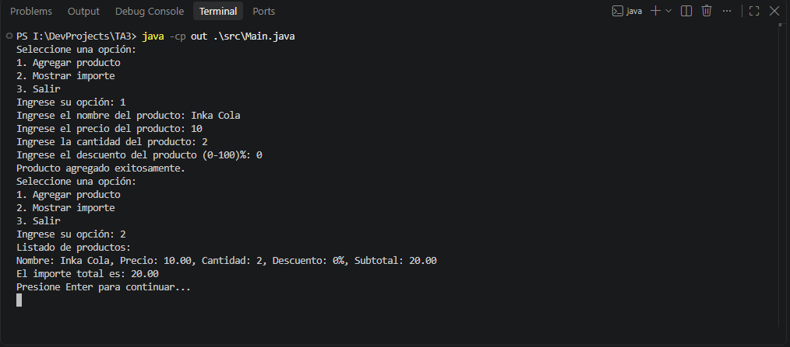
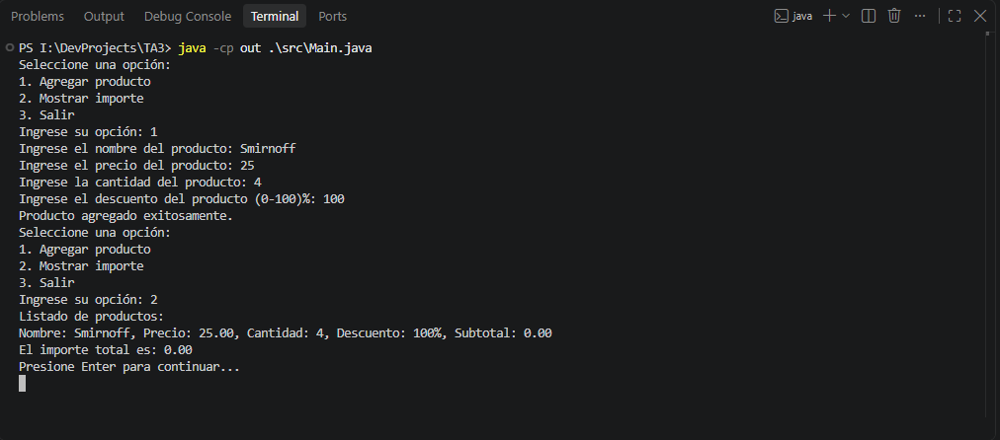
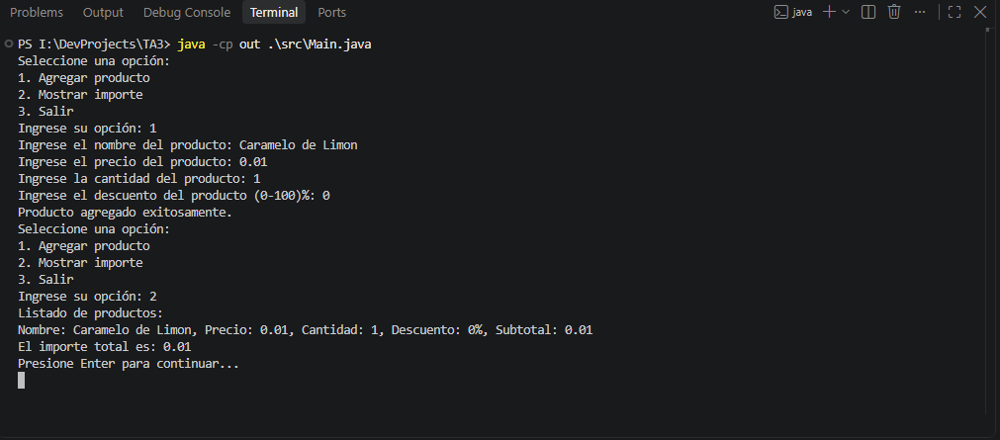
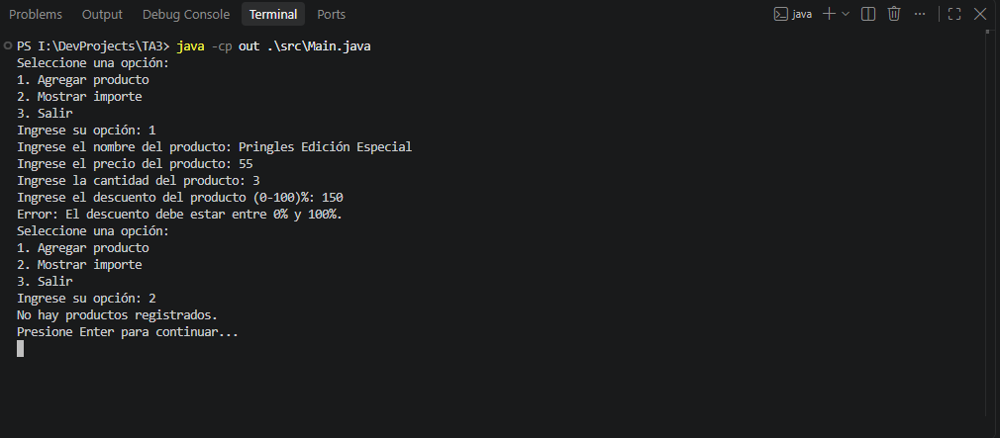
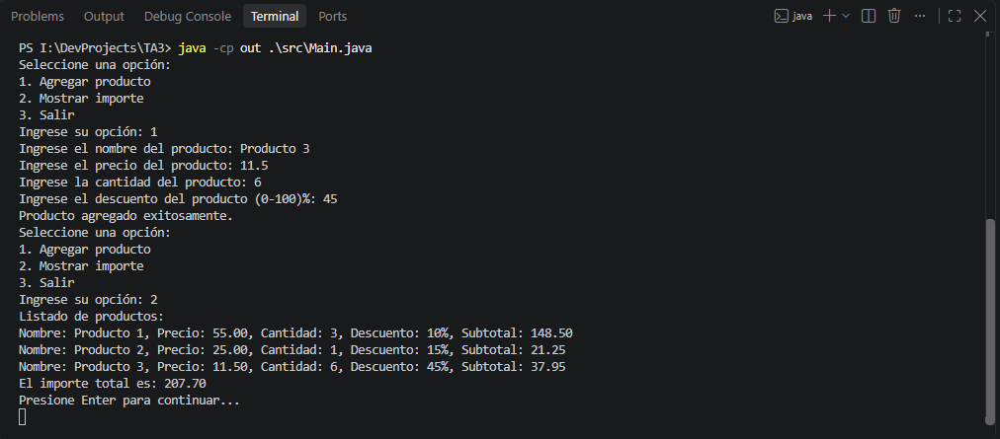

# Calculadora de compras (Java, consola)

Aplicación de consola que registra productos con **nombre, precio, cantidad y descuento (%)**, calcula el subtotal de cada uno y el **importe total** de la compra.

## Requisitos

JDK 17 o superior.

## Estructura del proyecto

```
TA3/
└── src/
    ├── Main.java                          
    ├── Interfaces/
    │   ├── ReglaValidation.java           
    │   └── LecturaEntrada.java            
    ├── Models/
    │   └── Product.java                   
    └── Services/
        ├── MenuService.java               
        ├── GuardarProductoService.java    
        ├── LecturaConsolaService.java     
        ├── CalcularSubtotalService.java   
        ├── CalcularTotalService.java      
        ├── MostrarListadoImporteService.java
        ├── MostrarTotalImporteService.java
        ├── PausaService.java              
        └── Validations/
            ├── ProductoValidation.java    
            ├── NombreValidation.java
            ├── PrecioValidation.java
            ├── CantidadValidation.java
            └── DescuentoValidation.java
```

## Compilar y ejecutar

Desde la carpeta `TA3`:

**Windows**
```powershell
java -cp out .\src\Main.java
```

## Uso

El menú tiene tres opciones:

1. **Agregar producto**: pide nombre, precio, cantidad y descuento, y lo guarda si es válido.
2. **Mostrar importe**: lista los productos con su subtotal y muestra el total.
3. **Salir**.

## Fórmula

```
subtotal = precio × cantidad × (1 − descuento / 100)
total    = suma de los subtotales
```

## Validaciones y manejo de errores

| Dato | Regla | Clase |
|---|---|---|
| Nombre | No puede estar vacío | `NombreValidation` |
| Precio | Mínimo 0.01 | `PrecioValidation` |
| Cantidad | Entre 1 y 100 | `CantidadValidation` |
| Descuento | Entre 0 % y 100 % | `DescuentoValidation` |
| Texto en lugar de número | Se muestra un aviso y se repite la pregunta | `LecturaConsolaService` |

## Tabla de pruebas

### Validación Nro. 1
| ID | Tipo | Entrada | Resultado esperado |
|---|---|---|---|
| N1 | Normal | Precio 10.00, cantidad 2, descuento 0 % | Subtotal 20.00 |


### Validación Nro. 2
| ID | Tipo | Entrada | Resultado esperado |
|---|---|---|---|
| N2 | Normal | Precio 50.00, cantidad 3, descuento 10 % | Subtotal 135.00 |


### Validación Nro. 3
| ID | Tipo | Entrada | Resultado esperado |
|---|---|---|---|
| N3 | Límite | Precio 25.00, cantidad 4, descuento 100 % | Subtotal 0.00 |


### Validación Nro. 4
| ID | Tipo | Entrada | Resultado esperado |
|---|---|---|---|
| N4 | Límite | Precio 0.01, cantidad 1, descuento 0 % | Subtotal 0.01 |


### Validación Nro. 5
| ID | Tipo | Entrada | Resultado esperado |
|---|---|---|---|
| N5 | Inválido | Precio 55.00, cantidad 3, descuento 150 % | Rechazado |


### Validación Nro. 6 (Cálculo del Importe Total)
| ID | Entrada | Resultado esperado |
|---|---|---|---|
| P1 | Precio 55.00, cantidad 3, descuento 10 % | 148.50 |
| P2 | Precio 25.00, cantidad 1, descuento 15 % | 21.25 |
| P3 | Precio 11.50, cantidad 6, descuento 45 % | 37.95 |

| Total de Importe |
|---|
| 207.70 |



## Explicación

La aplicación es una calculadora de compras de consola organizada en piezas pequeñas. Models contiene Product, que solo guarda nombre, precio, cantidad y descuento. Services agrupa una clase por tarea: mostrar el menú, guardar productos, calcular subtotales y total, mostrar resultados y pausar. Así se aplica la responsabilidad única y se puede cambiar una parte sin afectar las demás. Las validaciones usan polimorfismo: la interfaz ReglaValidation define el método validar, y NombreValidation, PrecioValidation, CantidadValidation y DescuentoValidation la implementan; ProductoValidation las recorre sin saber cuál es cuál, de modo que agregar una regla nueva no obliga a modificar las existentes. La lectura de datos también va detrás de una interfaz, LecturaEntrada, implementada por LecturaConsolaService, que repite la pregunta cuando el usuario escribe texto en lugar de un número; así el programa no se cae y puede probarse sin teclado. Los límites se definen como constantes, y los errores de reglas de negocio se manejan con IllegalArgumentException y un try/catch en GuardarProductoService, que impide agregar productos inválidos. Las cinco pruebas, dos normales, dos límite y una inválida, comprueban los subtotales y las reglas de validación. Todo se ejecuta solo con el JDK, sin librerías externas.
